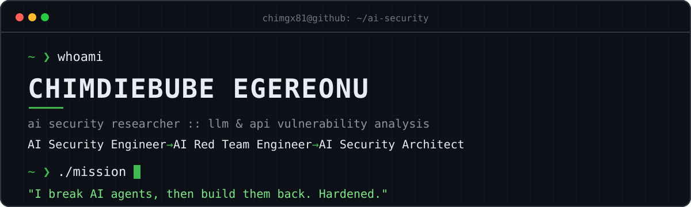

### I break AI agents, then build them back. Hardened.

---

### 👋 About

I'm Chimdiebube, an AI security researcher working at the point where LLMs meet infrastructure: vulnerability analysis of AI-powered applications, agentic attack surfaces, and audit tooling that makes both repeatable.

### 🔭 Currently building

`tilde`, a model-agnostic agentic harness for security engineering. Every day of work lands as a commit.

### 🎯 Focus areas

- **AI red teaming** · prompt injection · tool poisoning · memory extraction · agent hijacking
- **App & API security** · bug bounties on AI programs
- **Agentic engineering** · Python · Linux · Podman · Ollama

### 🧰 Toolbox

### 📫 Find me

---

  plan → build → test → attack → secure → repeat

